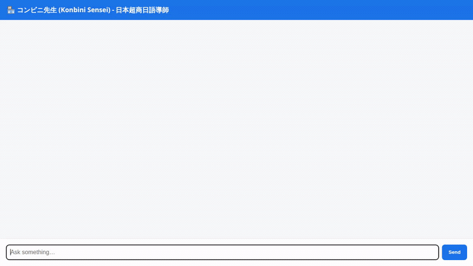

# 🏪 コンビニ先生 (Konbini Sensei)
### 沉浸式日本便利商店日語學習與情境對話導師 (ADK & Agent Runtime)



**コンビニ先生 (Konbini Sensei)** 是一個基於 **Google Agent Development Kit (ADK)** 與 **Agent Platform (Agent Runtime)** 建構的情境式對話 Agent。專為日語初學者（JLPT N5 / J3 程度）設計，將真實日本便利商店的購物情境轉化為互動式口說與會話練習場景。學習者可以在輕鬆的對話中練習便當微波、塑膠袋索取、會員集點、周邊超商探索，並透過豐富的視覺卡片與即時商品插圖加深學習記憶。

---

## 🌟 核心功能與特色

- **超商實戰情境對話**：提供道地的 N5 程度便利商店店員日常對話（如「いらっしゃいませ！」、「温めますか？」、「袋はどうなさいますか？」、「ポイントカードはお持ちですか？」），並提供平假名發音與中文文法詳解。
- **個人化長期記憶與過敏原把關**：透過 Vertex AI Memory Bank 跨對話記住使用者的過敏史（如花生、堅果、蛋、海鮮等），在推薦商品與結帳時主動進行食品安全提醒。
- **真實雲端商品庫存與資料庫互動**：串接 Firestore 即時資料庫，支援商品架上瀏覽、定價查詢、庫存盤點與購買交易。
- **多模態美食插圖生成**：呼叫 `gemini-3.1-flash-lite-image` 生成精緻美味的超商美食商品插圖，自動上傳至 Google Cloud Storage 並透過公開 HTTPS 連結呈現。
- **A2UI 結構化視覺介面**：使用 A2UI (v0.8 Basic Catalog) 渲染富文本卡片，在聊天介面中呈現商品清單與歡迎資訊。
- **真實日語辭典檢索**：串接 Jisho.org 公開辭典 REST API，提供單字發音、漢字寫法與例句釋義。
- **周邊超商地圖查詢**：整合 Google Maps Geocoding API 與 Places API (New)，可解析地址座標並查找周邊真實超商門市。

---

## ☁️ 整合之 Google Cloud 服務與技術堆疊

本專案於原始碼（`app/` 及相關模組）中實際整合並驗證了以下服務：

| 服務 / 技術組件 | 角色與用途 | 程式碼實作位置 |
| :--- | :--- | :--- |
| **Vertex AI Memory Bank** | 跨 Session 長期記憶服務，儲存使用者過敏原與個人化資訊 | `app/app_utils/services.py`, `app/agent.py` (`PreloadMemoryTool`, `generate_memories_callback`) |
| **Google Cloud Firestore** | NoSQL 雲端資料庫，儲存商品目錄、庫存數量、價格及學習者檔案 | `app/konbini_tools.py` (`list_shop_items`, `get_item_details`, `purchase_item`, `restock_item`, `get_learning_profile`) |
| **Google Cloud Storage** | 雲端物件儲存桶，託管由 AI 生成之商品插圖並提供公開 HTTPS 網址 | `app/konbini_tools.py` (`generate_item_image`) |
| **Gemini Multimodal Image Generation** | 調用 `gemini-3.1-flash-lite-image` 模型即時產出商品插圖 | `app/konbini_tools.py` (`generate_item_image`) |
| **A2UI (Agent-to-User Interface)** | v0.8 Basic Catalog 規範，將模型輸出封裝為結構化卡片 UI | `app/agent.py` (`A2uiSchemaManager`), `app/a2ui_utils.py` (`a2ui_callback`), `frontend/static/index.html` |
| **Agent Engine Code Execution Sandbox** | 雲端安全沙盒，提供隔離環境執行 Python 計算與資料處理 | `app/agent.py` (`AgentEngineSandboxCodeExecutor`) |
| **Google Maps Platform** | Geocoding API 與 Places API (New)，定位地址並搜尋附近超商 | `app/konbini_tools.py` (`geocode_address`, `find_nearby_places`) |
| **A2A Protocol (Agent-to-Agent)** | Google Agent Runtime 標準雙向通訊協議 | `agents-cli-manifest.yaml` (`is_a2a: true`), `frontend/main.py` |

---

## 🛠️ 工具清單 (Agent Tools)

Agent 在 `app/agent.py` 中掛載了以下自定義與內建工具：

1. `PreloadMemoryTool`：自 Vertex AI Memory Bank 預先載入使用者的歷史事實與過敏原偏好。
2. `list_shop_items`：自 Firestore 資料庫檢索便利商店架上商品清單（便當、飯糰、飲料、三明治等）。
3. `get_item_details`：自 Firestore 取得特定商品的詳細描述、庫存數量與未稅/含稅價格。
4. `purchase_item`：模擬商品結帳購買，於 Firestore 中即時扣減庫存並維護交易記錄。
5. `restock_item`：補充店內商品庫存量。
6. `get_learning_profile`：讀取使用者的日語學習者檔案、點數與連續登入紀錄。
7. `update_points_and_learning_log`：更新學習者的經驗點數與學習筆記。
8. `explain_grammar_and_phrase`：提供 N5 / J3 文法重點分析與超商實用句型解說。
9. `lookup_japanese_dictionary`：串接 Jisho.org 公開 API 進行日語單字查詢與讀音釋義。
10. `generate_item_image`：使用 Gemini 圖像生成模型生成商品插畫並上傳至 Cloud Storage。
11. `geocode_address`：使用 Google Maps Geocoding API 將地名/地址轉換為經緯度座標。
12. `find_nearby_places`：使用 Google Maps Places API (New) 搜尋指定地點附近的便利商店。

---

## 📌 規劃中但尚未實作之項目 (Planned, not yet implemented)

在 `project_brief.md` 規劃中，以下項目目前標記為規劃中或尚未實作：
- **獨立語法檢查器 (`check_dialogue_grammar`)**：*Planned, not yet implemented*（目前會話糾錯與文法解析由 Agent 透過系統 Prompt 及 `explain_grammar_and_phrase` 進行引導，未獨立開發特定 AST 文法檢查工具）。
- **Cloud Trace 端對端 Observability 儀表板**：*Planned, not yet implemented*（已具備基礎記錄，但尚未建立專屬的 BigQuery Agent Analytics 聚合看板）。

---

## 🚀 本地開發與執行指引 (Local Setup & Run)

### 1. 環境前置需求
- Python 3.12+
- [uv](https://docs.astral.sh/uv/) 套件管理工具
- Google Cloud SDK (`gcloud` CLI)，並完成認證：
  ```bash
  gcloud auth login
  gcloud auth application-default login
  ```

### 2. 安裝後端相依套件
在專案根目錄執行：
```bash
uv sync
```

### 3. 本地啟動 Agent Playground
透過 ADK 開發介面啟動即時測試環境：
```bash
agents-cli playground --host 0.0.0.0 --port 8080
```

### 4. 透過 CLI 直接對話測試
```bash
agents-cli run "你好，請推薦我一款無過敏原的便當"
```

### 5. 啟動自訂 Web 前端 (FastAPI 代理 + 聊天介面)
本專案包含獨立的前端代理與聊天 UI（位於 `frontend/` 目錄），支援原生 A2UI 卡片渲染：
```bash
cd frontend
pip install -r requirements.txt
export AGENT_ENGINE_RESOURCE_NAME="<YOUR_DEPLOYED_AGENT_RUNTIME_RESOURCE_NAME>"
export AGENT_DIRECTORY="app"
python main.py
```
啟動後即可透過瀏覽器造訪前端服務進行圖文對話體驗。

---

## 📁 專案目錄結構

```
konbini-sensei/
├── app/
│   ├── agent.py                 # ADK Agent 核心定義、Prompt 與工具組裝
│   ├── konbini_tools.py         # Firestore、GCS、Maps、Jisho 等外部工具實作
│   ├── a2ui_utils.py            # A2UI 回呼轉換工具 (after_model_callback)
│   ├── fast_api_app.py          # 後端服務入口
│   └── app_utils/               # 記憶體服務與共用模組
├── frontend/
│   ├── main.py                  # FastAPI A2A 代理伺服器
│   ├── requirements.txt         # 前端相依套件
│   ├── Dockerfile               # Cloud Run 容器映像檔定義
│   └── static/
│       └── index.html           # 輕量級聊天網頁與 A2UI 渲染器
├── assets/
│   └── demo.gif                 # 示範展示動態圖
├── demo_recordings/             # 展示影片錄製檔
├── agents-cli-manifest.yaml     # agents-cli 專案設定檔
├── deployment_metadata.json     # Agent Runtime 部署中繼資料
└── pyproject.toml               # Python 專案與套件設定
```
